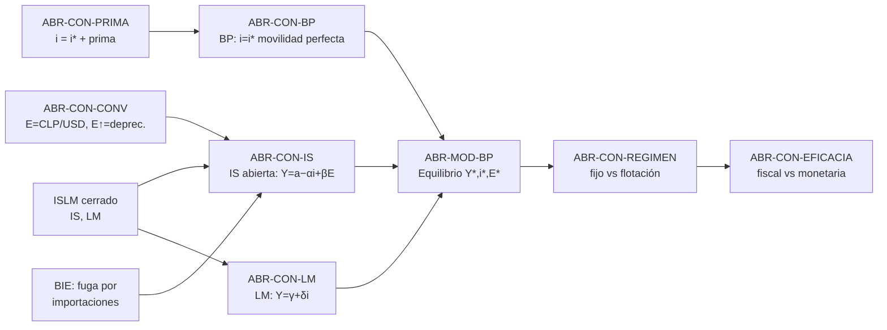

# Macroeconomía 1 — Miniunidad 5: IS-LM-BP en economía abierta (Mundell-Fleming)
## Reedición histórico-analítica

**Paquete:** `MAC-GRAPH-MVP` · **Bloque:** `ABR` · **Versión:** 0.2 (reedición de v0.1) · **Estado:** listo para clase
**Fuente rectora:** Programa 2025-2 (F1), Unidad 4 · **Texto base:** Blanchard 7ª (economía abierta)
**Materiales del curso usados:** Ayudantía 11 (IS-LM-BP), Nota de Estudio 10 (visión integrada)
**Prerrequisito:** `ISLM` (economía cerrada) · **Fecha de esta edición:** 2026-08-15

> Extiende el IS-LM a economía abierta con movilidad de capitales y régimen cambiario. Sella la **convención del tipo de cambio (E = CLP/USD)** — el crítico BL-01 de la auditoría — y desarrolla la eficacia de políticas bajo **flotación** y bajo **tipo de cambio fijo**.

> **Qué cambia respecto de v0.1.** Arquitectura intacta: misma convención sellada, mismo pasaporte, mismos cuatro ejercicios. **Las cuatro pautas selladas fueron recalculadas con aritmética exacta el 2026-08-15 y son correctas en todos sus valores** — a diferencia del bloque `ISLM`, aquí no hubo hallazgos. Se agrega el ancla histórica: Chile **flota**, de modo que la columna "flotación" de la tabla de eficacia es la que describe al país; y se incorpora el episodio de 2021 —cobre al alza y peso depreciándose al mismo tiempo— que obliga a distinguir el canal comercial del financiero. Rosa Millán continúa desde los cuatro bloques anteriores.

> **Convenciones de gobierno aplicadas** (`GOB-CONV-ED` y `GOB-CONV-TC`): formato numérico chileno, regla **coincidencia frente a regla**, tasas en por ciento, **E = CLP/USD con E↑ = depreciación**.

---

## 0. Convención sellada del tipo de cambio (resuelve BL-01) y alcance

**Convención del curso (a fijar antes de todo ejercicio):**

- **E = CLP/USD** = precio del dólar en pesos (cotización directa).
- **E ↑ = depreciación nominal** del peso (el dólar cuesta más pesos).
- **Depreciación mejora las exportaciones netas:** `XN = x0 − x1·Y + x2·E`, con **x2 > 0** (el coeficiente de E es **positivo**).
- **Tasas en porcentaje** (i* = 6 significa 6 %, **no** 0,06): mantener consistencia con los coeficientes calibrados en %.

> Con esta convención, en la IS el término de E entra **con signo +** (E↑ ⇒ Y↑ vía XN) y el de la tasa con **signo −** (i↑ ⇒ Y↓). Esta hoja es la referencia única: cualquier ejercicio que no la declare se reabre (ABR-ERR-01).

**Alcance:** movilidad **perfecta** de capitales (BP horizontal en i = i*), dos regímenes cambiarios (flotación y fijo), y la eficacia comparada de política fiscal y monetaria. Marshall-Lerner / curva J y movilidad imperfecta quedan como extensiones futuras.

IDs: `ABR-CON-*`, `ABR-MOD-*`, `ABR-CIR-*`, `ABR-ERR-*`, `ABR-EX-*`.

### 0.1 El quiebre que abre el bloque: el año en que el cobre subió 51 % y el peso se depreció igual

A Rosa la harina le llegó más cara en 2021 y ella no entendía por qué. *"Si a Chile le está yendo bien con el cobre, ¿no debería estar más barato el dólar?"*

Es exactamente la pregunta correcta, y la respuesta es que **hay dos canales tirando en sentidos opuestos**.

| Hecho de 2021 | Valor | Canal | Qué predice para E |
|---|---|---|---|
| Precio del cobre, promedio anual | 280 → **423** US$cent/lb (**+51,1 %**) | **Comercial**: más dólares entrando por exportaciones | E **baja** (apreciación) |
| Salida hacia activos externos por incertidumbre y liquidaciones previsionales | mayor demanda por depósitos e instrumentos en dólares | **Financiero**: más demanda de dólares | E **sube** (depreciación) |
| **Resultado observado** | **el peso se depreció casi 18 % durante 2021** | **ganó el financiero** | E **subió** |

El IPoM lo dice sin rodeos: *"a pesar del alto precio del cobre y del mayor diferencial de tasas, el peso ha tenido una depreciación significativa (casi 18 %) durante el 2021"* (IPoM, BCCh, diciembre-2021).

> **La disciplina que instala este bloque:** frente a cualquier noticia cambiaria hay que preguntar **por cuál de los dos canales** opera, y **cuál domina**. Un modelo que solo mire el comercio se habría equivocado de signo todo el año 2021.

`[Ilustración sugerida: dos flechas opuestas sobre el eje de E —"cobre +51 %" empujando hacia abajo y "salida de capitales" empujando hacia arriba— con el resultado neto de +18 % marcado.]`

### 0.2 Chile flota: cuál columna de la tabla de eficacia hay que leer

Chile opera con **flotación cambiaria** dentro de un esquema de metas de inflación — el propio marco de política del Banco Central lo declara al describir el régimen que Chile comparte con otros países. Eso tiene una consecuencia inmediata y fuerte para este bloque: **la columna operativa de la tabla de eficacia es la de flotación**, donde el modelo, bajo movilidad perfecta, concluye que la política fiscal es impotente sobre `Y`.

Esa conclusión es tan fuerte que exige declarar de inmediato el supuesto que la produce (§3.2): **movilidad perfecta de capitales**, es decir `i = i*` exactamente. Chile tiene movilidad alta, **no perfecta**, y la diferencia es visible en los datos.

---

## 1. Grafo de prerrequisitos



*Las cuatro relaciones de v0.1 quedan `[Sin cambios respecto de la versión anterior — ver §1 del original]`.* Se agregan dos:

| subject_id | relation_type | object_id |
|---|---|---|
| ABR-CON-PRIMA | MODIFICA | ABR-CON-BP |
| BIE-ERR-06FUGA | SE_FORMALIZA_EN | ABR-CON-XN |

---

## 2. Conceptos clave y homónimos

| ID | Concepto | Distinción crítica | Homónimo peligroso |
|---|---|---|---|
| ABR-CON-CONV | Convención de E | E = CLP/USD; E↑ = depreciación | cotización inversa (USD/CLP) invierte todo |
| ABR-CON-BP | Curva BP (movilidad perfecta) | Horizontal en i = i*; el capital fija la tasa | ≠ balanza comercial |
| ABR-CON-REGIMEN | Régimen cambiario | Flotación: Ms fijo, E ajusta. Fijo: BC mueve Ms para defender E | mezclar los dos |
| ABR-CON-EFICACIA | Eficacia de política | Depende del régimen (ver tabla) | asumir que la fiscal siempre funciona igual |
| ABR-CON-XN | Exportaciones netas | XN = x0 − x1·Y + x2·E (x2 > 0) | signo de E |
| **ABR-CON-PRIMA** ⊕ | Prima por riesgo país | La condición real es `i = i* + prima`, y la prima **se mueve** | tratar `i = i*` como identidad |
| **ABR-CON-CANALES** ⊕ | Canal comercial vs canal financiero | El comercio mueve E por bienes; las finanzas por carteras, y **son mucho más rápidas** | explicar el dólar solo con exportaciones |

⊕ = nuevo en v0.2.

> **Primera bifurcación (antes que la política): el régimen.** No se puede evaluar un shock sin declarar flotación vs. fijo y la movilidad de capitales.

### 2.1 Ancla histórica por concepto

| Concepto | Ancla histórica chilena | Qué error habría cometido quien no domina el concepto |
|---|---|---|
| ABR-CON-CANALES | 2021: cobre **+51,1 %** (280 → 423 US$cent/lb) y **peso depreciado casi 18 %** (IPoM, BCCh, dic-2021) | Predecir apreciación por el precio del cobre y equivocarse de signo todo el año |
| ABR-CON-PRIMA | En 2021 las tasas largas chilenas subieron el **doble** que en economías comparables, atribuido a *"mayor percepción de riesgo"* (ídem) | Usar `i = i*` literalmente y no ver el diferencial |
| ABR-CON-XN | Importaciones **+31,3 %** en 2021 con PIB **+11,7 %**: la fuga que el bloque `BIE` no podía modelar | Aplicar el multiplicador cerrado a Chile |
| ABR-CON-REGIMEN | Chile **flota** dentro de un esquema de metas de inflación | Leer la columna de tipo de cambio fijo al analizar Chile |
| Ajuste externo | Cuenta corriente: **−6,6 %** del PIB (2021) → **−8,7 %** (2022) → **−1,2 %** (2025) → **−0,6 %** al 1T-2026 | Creer que un déficit alto es permanente, o que se corrige sin ajuste del gasto |
| Shock de términos de intercambio | Julio 2026: petróleo (WTI-Brent) cerca de **US$100** el barril, **+14 %** respecto de la Reunión anterior (Minuta RPM, julio-2026) | Tratar un shock de precio externo como si fuera un shock de demanda interna |

---

## 3. Pasaporte `ABR-MOD-BP`

**El quiebre.** Rosa importa parte de su harina. Cuando el dólar sube, su costo sube y no puede hacer nada. Cuando el dólar sube, además, el pan chileno se vuelve más competitivo frente al importado y ella vende más. **Las dos cosas ocurren a la vez y con distinta velocidad**: el costo le llega el mes siguiente, la ventaja competitiva tarda mucho más. Ese desfase es el corazón del canal comercial.

```yaml
id: ABR-MOD-BP
tipo: Modelo
pregunta: "¿Cómo cambia la eficacia de políticas y shocks externos según el régimen cambiario y la movilidad de capitales?"
endogenas: [Y, i, E (flotación) o Ms (fijo)]
exogenas: [i*, x0, G, y Ms/P (flotación) o E (fijo)]
convencion: "E = CLP/USD; E↑ = depreciación; XN = x0 − x1·Y + x2·E con x2 > 0; tasas en %."
ecuaciones:
  IS:  "Y = a − α·i + β·E     (forma lineal, β>0)"
  LM:  "Y = γ + δ·i"
  BP:  "i = i*                (movilidad perfecta ⇒ BP horizontal)"
orden_de_solucion:
  flotacion: "1) LM∩BP ⇒ i=i* ⇒ Y* desde LM.  2) IS con (Y*,i*) ⇒ despejar E*."
  fijo:      "E dado; el BC ajusta Ms/P para sostener i=i* ⇒ Y lo fija la IS."
ajuste_horizonte: "Flujos financieros y E ajustan antes que comercio y Y. Corto plazo."
limites: "Movilidad perfecta (i = i* sin prima); Marshall-Lerner/curva J y pass-through fuera del modelo básico."
errores_objetivo: [ABR-ERR-01, ABR-ERR-02, ABR-ERR-03, ABR-ERR-04, ABR-ERR-05PRIMA]  # ← ampliado en v0.2
macrolab: "Uso directo de la pestaña IS-LM-BP; verificar convención de E."
fuente: {id: F1, unidad: 4}
version: 0.2.0
estado: aprobado
```

**Eficacia de política (movilidad perfecta):**

| Política | Flotación | Tipo de cambio fijo |
|---|---|---|
| **Fiscal** (ΔG) | **Impotente sobre Y**: BP horizontal fija Y en LM∩BP; el impulso se drena por apreciación de E (↓XN) | **Potente**: el BC acomoda Ms para sostener E; Y sube |
| **Monetaria** (ΔMs) | **Potente**: LM se desplaza, Y sube, E se deprecia | **Impotente**: cualquier ΔMs se revierte por flujos de capital al defender E |

> Mnemónico: **cada régimen "apaga" una política.** Flotación mata la fiscal; fijo mata la monetaria (bajo movilidad perfecta).

---

### 3.1 ⊕ Los dos canales, y por qué el financiero suele llegar primero

**El punto que hay que instalar antes de cualquier cálculo.** El tipo de cambio se mueve por dos razones distintas:

| | **Canal comercial** | **Canal financiero** |
|---|---|---|
| Qué lo mueve | Exportaciones e importaciones de bienes y servicios | Compra y venta de activos: bonos, depósitos, acciones |
| Velocidad | Meses; embarques, contratos, cosechas | **Horas**; basta una orden |
| En el modelo | `XN = x0 − x1·Y + x2·E` | `i = i*` (la BP) |
| Ejemplo chileno | El cobre alto de 2021 | Las salidas hacia activos externos de 2021 |

**Por qué esto importa tanto en la práctica.** Los flujos financieros son órdenes de magnitud más rápidos que los comerciales. Por eso, ante una noticia, **el tipo de cambio reacciona primero al canal financiero** aunque los fundamentos comerciales apunten al lado contrario. El año 2021 es el ejemplo perfecto: el cobre subió **51,1 %** —fundamento comercial fuerte hacia la apreciación— y aun así el peso se depreció **casi 18 %**, porque la incertidumbre y las liquidaciones previsionales empujaron capitales hacia afuera.

**Conexión con el error objetivo.** `ABR-ERR-06CANAL` ⊕ (nuevo): explicar el tipo de cambio solo por el comercio, ignorando la cartera.

> **Coincidencia frente a regla.** (1) En 2021 el peso se depreció pese al cobre alto. (2) Ocurrió **porque** ese año el shock financiero fue excepcionalmente grande. (3) **Deja de cumplirse** en períodos tranquilos, cuando el canal comercial sí domina y un cobre alto se asocia a un peso más fuerte. **No existe la regla "el cobre no afecta al dólar"**: existe la regla de que hay que mirar los dos canales y ver cuál pesa más.

---

### 3.2 ⊕ El supuesto que sostiene la conclusión más fuerte del bloque

El modelo dice, bajo flotación, que **la política fiscal es impotente sobre `Y`**. Es una conclusión grande y conviene mostrar de qué depende, porque un estudiante que se la lleve sin condiciones la aplicará mal toda su vida profesional.

**Depende íntegramente de la BP horizontal**, es decir de `i = i*`: movilidad **perfecta** de capitales. Si la tasa doméstica no puede despegarse de la externa, cualquier presión al alza de `i` atrae capitales instantáneamente, aprecia el peso y drena el impulso fiscal vía `XN`.

**Chile no cumple ese supuesto de forma exacta.** La condición realista es:

```
i = i* + prima por riesgo país (+ expectativa de depreciación)
```

y **la prima se mueve**. El IPoM de diciembre de 2021 lo documenta: el alza de tasas largas chilenas *"dobla lo observado en un conjunto de economías comparables"*, con *"una parte significativa explicada por la mayor percepción de riesgo"*. Si `i` puede separarse de `i*`, la BP no es exactamente horizontal, la impotencia fiscal no es total, y **el resultado del modelo pasa de ser un teorema a ser una tendencia**.

**Conexión con el error objetivo.** `ABR-ERR-05PRIMA` ⊕ (nuevo): tratar `i = i*` como identidad y concluir que la política fiscal chilena "no sirve".

**Límite declarado.** Este bloque **mantiene** el supuesto de movilidad perfecta porque es el que permite resolver el modelo con las herramientas del curso. Lo que agrega v0.2 es la **obligación de decir en voz alta que es un supuesto**, y de nombrar la dirección en que sesga la conclusión: **exagera la impotencia fiscal bajo flotación**.

`[Ilustración sugerida: tres BP superpuestas —horizontal (movilidad perfecta), con pendiente suave (movilidad alta), y desplazada hacia arriba por un alza de la prima— sobre el mismo par IS-LM.]`

---

### 3.3 ⊕ El ajuste externo chileno 2021-2026, leído con el modelo

La cuenta corriente cuenta la historia del bloque en una sola fila de números.

| Año | Cuenta corriente (% del PIB) | Qué estaba pasando |
|---|---|---|
| 2021 | **−6,6 %** | Boom de demanda interna: importaciones **+31,3 %** |
| **2022** | **−8,7 %** | Peak del déficit; el gasto interno todavía por sobre la capacidad |
| 2023 | −3,2 % | Ajuste: demanda interna **−3,7 %**, importaciones **−10,9 %** |
| 2024 | −1,2 % | Consolidación, con exportaciones **+7,2 %** |
| 2025 | −1,2 % | Estabilidad |
| 1T-2026 | **−0,6 %** | Mejora por términos de intercambio (cobre y litio) |

**Lectura con el modelo.** El déficit de cuenta corriente **no se cerró por una devaluación** ni por una política cambiaria: se cerró porque **cayó la demanda interna**, y con ella las importaciones — el término `−x1·Y` de la ecuación de `XN`. De **−8,7 %** a **−1,2 %** del PIB hay **7,5 puntos porcentuales** de ajuste en tres años, y el mecanismo principal fue `Y`, no `E`.

> **Este es el punto más contraintuitivo del bloque y conviene decirlo explícitamente:** en la ecuación `XN = x0 − x1·Y + x2·E`, la prensa habla casi siempre de `E` y el ajuste chileno reciente ocurrió sobre todo por `Y`.

**Límite.** La cuenta corriente incluye además el saldo de rentas —**−5,6 % del PIB** al 1T-2026, ligado a la inversión extranjera directa (§`MED` 3.6)—, que **no** es comercio de bienes y no responde a `E` del modo en que lo hace `XN`. La descomposición completa pertenece a la Balanza de Pagos, que este curso trata como lectura, no como modelo.

---

## 4. Circuito `ABR-CIR-01` — Economía abierta

```
Shock externo/interno → Convención → Régimen → Canal financiero → Canal comercial →
Curvas → Equilibrio → Política → Horizonte → Evidencia/revisión
```

| Paso | Pregunta de control |
|---|---|
| Shock | ¿Cambia x0, i*, G, Ms/P, expectativas, la **prima por riesgo** o términos de intercambio? |
| Convención | Declare E = CLP/USD: E↑ es depreciación. |
| Régimen | ¿Flotación o fijo? ¿Movilidad perfecta? **¿Se sostiene ese supuesto en el caso analizado?** |
| Canal financiero | ¿Cómo cambian flujos, diferencial de tasas y E? **Llega primero.** |
| Canal comercial | ¿Cómo cambia XN, con qué rezago y elasticidades? **Llega después.** |
| Curvas | ¿Se desplaza IS, LM o BP? |
| Equilibrio | Compare Y, i, E; **Y estable NO implica ausencia de ajuste** (ajusta E). |
| Política | ¿Qué instrumento queda disponible bajo el régimen? |
| Horizonte | ¿Marshall-Lerner / curva J alteran el corto plazo? |
| Evidencia/revisión | Observe CLP/USD, cobre, i*, spreads, XN, precios importados. |

**Producto:** mapa de doble canal (financiero/comercial) + comparación de variables + condición de régimen.
**Regla de revisión:** reabrir si no se declara convención de E, régimen u horizonte comercial, **o si se explicó un movimiento del tipo de cambio con un solo canal**.

---

## 5. Errores objetivo del bloque

| ID | Error | Consecuencia | Sonda diagnóstica |
|---|---|---|---|
| ABR-ERR-01 | Signo de E invertido / convención no declarada | Invierte el canal externo | Exigir declarar E = CLP/USD en cada ejercicio |
| ABR-ERR-02 | "Y no cambia ⇒ no hubo ajuste" (bajo flotación) | Pierde el canal principal (E) | Comparar el vector (Y, i, E), no solo Y |
| ABR-ERR-03 | Omitir el régimen antes de evaluar la política | Conclusión de eficacia errónea | Preguntar régimen y movilidad primero |
| ABR-ERR-04 | Usar i = 0,06 en vez de 6 con coeficientes en % | Escalas inconsistentes | Verificar unidades de tasa vs coeficientes |
| **ABR-ERR-05PRIMA** ⊕ | Tratar `i = i*` como identidad y no como supuesto | Concluye impotencia fiscal absoluta; ignora que la prima se mueve y que la BP puede tener pendiente | Pedir el diferencial observado entre la tasa chilena y la externa en el episodio analizado |
| **ABR-ERR-06CANAL** ⊕ | Explicar el tipo de cambio con un solo canal (casi siempre el comercial) | Predice el signo equivocado cuando domina la cartera, como en 2021 | Pedir los dos canales por separado y una razón para decidir cuál domina |

---

## 6. Ejercicios semilla (con pauta sellada y verificada) — de tu Ayudantía 11

**Datos base (P = 1):** C = 30 + 0,75(Y − T); T = 80; I = 60 + 0,15Y − 0,25i; G = 120; XN = 50 − 0,10Y + 0,30E; Ms/P = 900; Md = 60 + 0,50Y − 0,20i; i* = 6.

> **Verificación v0.2.** Las cuatro pautas de este bloque fueron rederivadas con aritmética exacta el 2026-08-15. **Todas correctas; ninguna cifra cambió.**

### `ABR-EX-01` — Equilibrio bajo flotación + movilidad perfecta · derivación · intermedia
**Errores objetivo:** ABR-ERR-01, ABR-ERR-04.
**Pauta sellada (confirmada):**
- **IS:** constantes (−30 + 60 + 120 + 50) = 200; coef. de Y (0,75 + 0,15 − 0,10) = 0,80 ⇒ 0,2Y = 200 − 0,25i + 0,30E ⇒ **Y = 1.000 − 1,25i + 1,5E**.
- **LM:** 900 = 60 + 0,5Y − 0,2i ⇒ **Y = 1.680 + 0,4i**.
- **BP:** i = i* = 6 ⇒ **Y\* = 1.680 + 0,4·6 = 1.682,4**.
- **E\*:** 1.682,4 = 1.000 − 1,25·6 + 1,5E = 992,5 + 1,5E ⇒ **E\* ≈ 459,93**.

> **Nota de escala (v0.2).** `E ≈ 460` en este ejercicio es un valor del modelo, no una predicción del peso chileno. Coincide en orden de magnitud con niveles históricos del CLP/USD, lo que ayuda a la intuición, pero **no debe presentarse como un pronóstico** (`MED-ERR-24`).

### `ABR-EX-02` — Shock fiscal ΔG = +40 bajo flotación · predicción-revisión · avanzada
**Errores objetivo:** ABR-ERR-02, ABR-ERR-03.
**Pauta sellada (confirmada):** multiplicador = 1/0,2 = 5; ΔG·m = 200 ⇒ nueva IS: **Y = 1.200 − 1,25i + 1,5E**. Como LM∩BP no cambia, **Y sigue en 1.682,4** e i = 6; despejando E: 1.682,4 = 1.200 − 7,5 + 1,5E ⇒ **E ≈ 326,60**. **Interpretación:** E **baja (apreciación)**; XN cae y neutraliza el impulso fiscal ⇒ **fiscal impotente sobre Y bajo flotación** (el ajuste es todo en E, no en Y — ABR-ERR-02 evitado).

**Advertencia obligatoria (v0.2).** Esta impotencia es **exacta solo bajo movilidad perfecta** (§3.2). Con prima por riesgo variable la BP no es horizontal y el drenaje es **parcial**. Al corregir, se exige que el estudiante nombre el supuesto (`ABR-ERR-05PRIMA`).

### `ABR-EX-03` — Expansión monetaria ΔMs = +200 bajo flotación · avanzada
**Pauta sellada (confirmada):** nueva LM: 1.100 = 60 + 0,5Y − 0,2i ⇒ **Y = 2.080 + 0,4i**; con i = 6 ⇒ **Y = 2.082,4**. IS original (G sin cambio): 2.082,4 = 992,5 + 1,5E ⇒ **E ≈ 726,60**. **Comparación:** Y **sube** (LM→derecha), i sigue en i*, E **sube (depreciación)** para que XN acompañe el mayor Y ⇒ **monetaria potente bajo flotación**.

**Ancla real (v0.2).** Esta es la lógica de fondo del régimen chileno: bajo flotación, el instrumento que sí muerde es el monetario, y por eso el Banco Central lo usa como su herramienta principal (bloque `DIN`).

### `ABR-EX-04` — Shock fiscal ΔG = +40 bajo tipo de cambio **fijo** · avanzada
**Errores objetivo:** ABR-ERR-03.
**Pauta sellada (confirmada):** E fijo en E* = 459,93, i = i* = 6. La IS (con ΔG) determina Y: Y = 1.200 − 1,25·6 + 1,5·459,93 = 1.200 − 7,5 + 689,9 ⇒ **Y = 1.882,4**. Para sostener i = 6 y ese Y, el BC fija Ms/P = Md = 60 + 0,5·1.882,4 − 0,2·6 = **1.000** (sube de 900 a 1.000). Nueva LM: **Y = 1.880 + 0,4i** (pasa por (1.882,4; 6)). **Intuición:** bajo fijo el BC acomoda Ms para defender E ⇒ **fiscal potente** (Y↑), **monetaria estéril** (cualquier ΔMs autónomo se revierte por flujos de capital).

**Nota de contexto (v0.2).** Chile **no** está en este régimen. El ejercicio se resuelve para entender por contraste qué gana y qué pierde un país al fijar: gana potencia fiscal, **pierde la política monetaria**, que es justamente el instrumento con el que el BCCh conduce la inflación hacia la meta de 3 %.

---

### ⊕ `ABR-EX-05` — El puzzle de 2021: cobre al alza y peso a la baja · diagnóstico de canales · avanzada

**Errores objetivo:** ABR-ERR-06CANAL, ABR-ERR-05PRIMA, ABR-ERR-01.
**Marco narrativo.** Rosa pregunta por qué le subió la harina importada en el mejor año del cobre en una década.

**Datos entregados al estudiante** (todos oficiales; trazabilidad en §12):

| Dato | Valor |
|---|---|
| Precio del cobre, promedio anual 2020 → 2021 | 280 → **423** US$cent/lb |
| Variación del peso durante 2021 | **depreciación de casi 18 %** |
| Tasas largas chilenas en 2021 (BTP-10) | **+300 pb**, el **doble** que en economías comparables |
| Causa señalada del alza de tasas largas | liquidaciones masivas de ahorros previsionales; incertidumbre político-legislativa; **mayor percepción de riesgo** |
| Comportamiento de cartera observado | mayor demanda por depósitos y cuentas corrientes en dólares e instrumentos que invierten en el exterior |
| Importaciones 2021 · demanda interna 2021 | +31,3 % · +21,6 % |
| Cuenta corriente 2021 | **−6,6 %** del PIB |

**Se pide:**
1. Calcule la variación porcentual del precio del cobre y diga, **usando la convención sellada**, qué le habría hecho a `E` si solo operara el canal comercial.
2. Describa el canal financiero de ese año y qué le hace a `E`.
3. El peso se depreció. ¿Qué canal dominó? Justifique con un argumento de **velocidad y magnitud**, no de preferencia.
4. En el modelo, la BP es horizontal en `i = i*`. ¿Es compatible con que las tasas chilenas hayan subido el doble que las comparables? ¿Qué habría que agregar al modelo?
5. Enuncie una afirmación que estos datos **no** permiten sostener.

**Pauta sellada (verificada computacionalmente el 2026-08-15):**

1. `423/280 − 1 = **+51,1 %**`. Con la convención `E = CLP/USD`, más dólares entrando por exportaciones significa mayor oferta de dólares ⇒ el dólar se abarata en pesos ⇒ **`E` baja: apreciación**. El canal comercial, solo, predice apreciación.
2. Salida de capitales: los agentes aumentan su demanda de activos en moneda extranjera, es decir **compran dólares** ⇒ mayor demanda de dólares ⇒ **`E` sube: depreciación**. En el modelo esto corresponde a un aumento de la **prima por riesgo**, que desplaza la BP hacia arriba.
3. Dominó el **financiero**: el resultado observado fue depreciación de casi 18 %. El argumento es de **velocidad y magnitud** — una recomposición de cartera se ejecuta en horas y movilizó volúmenes muy grandes (los retiros previsionales sumaron una fracción relevante del PIB, §`BIE`), mientras que el mayor ingreso por cobre entra a lo largo de meses y por embarques.
4. **No es compatible con `i = i*` estricto.** Si la tasa doméstica sube el doble que la de economías comparables, existe un diferencial persistente, es decir **`i = i* + prima`** con prima **creciente**. Habría que (a) agregar la prima a la BP y (b) permitir que la BP se **desplace** cuando cambia la percepción de riesgo — y, en un modelo más fino, darle **pendiente** (movilidad imperfecta). Es `ABR-ERR-05PRIMA` en su forma constructiva.
5. Cualquiera de estas: *"el precio del cobre no afecta al tipo de cambio"* (sí lo afecta; ese año fue superado por otro canal — `ABR-ERR-06CANAL` invertido); *"la depreciación se debió a los retiros"* como afirmación causal única (el IPoM menciona **varios** factores y no cuantifica cada uno); *"con flotación el tipo de cambio siempre absorbe el shock"* (absorbió parte; la cuenta corriente igual se deterioró a −6,6 % del PIB).

**Evidencia de dominio:** separa los dos canales con signo correcto, no elige el ganador por intuición sino por velocidad y magnitud, y **propone la modificación del modelo** en el punto 4 en lugar de descartar el modelo.

`[Ilustración sugerida: 2021 en dos paneles —precio del cobre subiendo y CLP/USD subiendo a la vez— con una nota que marque que ambos suben, lo que el canal comercial solo no puede explicar.]`

---

## 7. Plantilla de narración (retirada gradual)

**Nivel A:** Declaro convención E = CLP/USD ___ y régimen ___ · el shock afecta ___ · canal financiero: i y flujos ___ · canal comercial: XN ___ · **cuál llega primero y cuál domina** ___ · se desplaza la curva ___ · orden de solución (flotación: LM∩BP→Y*, luego IS→E; fijo: IS→Y, BC ajusta Ms) ___ · nuevo (Y, i, E) = ___ · el instrumento disponible es ___ · **el supuesto de movilidad perfecta sesga la conclusión hacia** ___ · revisaría si ___.
**Nivel B:** régimen → curva → orden de solución → (Y,i,E) → eficacia de política → supuesto.
**Nivel C:** *"Resuelva el equilibrio bajo el régimen indicado, compare el vector (Y,i,E) y explique por qué una de las dos políticas es impotente."*

### 7.1 ⊕ Retirada gradual en la narrativa

| Nivel | Quién narra | Tarea del estudiante |
|---|---|---|
| **A** | El docente desarrolla el puzzle de 2021 completo (§0.1 y §3.1) | Identificar canal, signo y dominancia en el relato ya hecho |
| **B** | Se entrega el **ajuste externo 2022-2025** con la serie de cuenta corriente | Explicar el cierre del déficit por `Y` y no por `E`, con la ecuación de XN a la vista |
| **C** | Se entrega **la minuta de RPM de julio de 2026**, cruda | Clasificar el shock del petróleo (¿externo, de términos de intercambio, de qué curva?), declarar régimen y convención, y predecir el vector (Y, i, E) |

**Insumo listo para el Nivel C.** En julio de 2026 el petróleo (WTI-Brent) volvió a cerca de **US$100** el barril, **+14 %** respecto de la Reunión anterior, por la escalada del conflicto en Medio Oriente. Chile es **importador** de petróleo: es un deterioro de términos de intercambio. El estudiante debe declarar la convención, ubicar el shock (afecta `x0` y, vía costos, la inflación), y explicar por qué la respuesta de política no es obvia — el shock sube precios y baja actividad a la vez, lo que anticipa el bloque `OADA`.

---

## 8. Mapeo a la evaluación del programa

| Instrumento (peso) | Piezas | Cómo |
|---|---|---|
| **Controles (15 %)** | ABR-EX-01 | Derivar IS/LM/BP y hallar E* |
| **Trabajo de aplicación (15 %)** | ABR-EX-02/03 + **ABR-EX-05** + noticia CLP/USD o cobre real | Predice el efecto sobre (Y,i,E) y contrasta con datos |
| **Solemne 2 / Examen (40 % y 30 %)** | ABR-EX-04 + comparación de regímenes | Eficacia fiscal/monetaria bajo fijo vs flotación |

Referencia real: la Solemne 2 y el Examen 2025 (en `Pruebas_Macro1`) incluyen economía abierta; calibrar contra esas pautas.

**Regla de corrección:** no declarar la convención de E o el régimen se corrige como error de **formulación**. **Afirmar impotencia fiscal sin nombrar el supuesto de movilidad perfecta se corrige igual**, aunque el cálculo sea correcto.

---

## 9. Integración con MacroLab

> **Dónde vive este bloque.** En la **capa superior** de MacroLab —el Shock Simulator publicado en `pavelgomez.github.io/MacroLab-Shock-Simulator/`—, pestaña **IS-LM-BP**. La sub-app `macro1/` (cinco ventanas de laboratorio) cubre medición, bienes, dinero y laboral; la economía abierta está arriba.

### ⚑ Verificación cruzada de las cuatro pautas contra el propio simulador

El módulo IS-LM-BP expone `c₀, c₁, b₀, b₁, b₂, x₀, x₁, x₂, G, T, M/P, d₁, d₂, i*` y entrega `Y`, `i = i*`, un **índice de tipo de cambio** y `NX`. Se ejecutó su solver (`calcISLMBP`) con los datos base de la Ayudantía 11 el 2026-08-15:

| Ejercicio | Pauta sellada | MacroLab |
|---|---|---|
| `ABR-EX-01` | Y = 1.682,4 · E ≈ 459,93 | **1.682,4 · 459,93** ✔ |
| `ABR-EX-02` (ΔG = +40) | Y = 1.682,4 (sin cambio) · E ≈ 326,60 | **1.682,4 · 326,60** ✔ |
| `ABR-EX-03` (ΔMs = +200) | Y = 2.082,4 · E ≈ 726,60 | **2.082,4 · 726,60** ✔ |

Las tres coinciden al decimal. El simulador entrega además `NX ≈ 19,74` en el caso base, un dato que la pauta no calculaba y que puede pedirse como ítem adicional.

> **Salvedad de calibración, importante al cargar los datos.** La demanda de dinero de la Ayudantía 11 es `Md = 60 + 0,50Y − 0,20i`, con una **constante de 60** que el módulo no tiene (su forma es `Md = d₁Y − d₂i`). Para reproducir el ejercicio hay que ingresar **`M/P = 840`**, no 900: es decir `900 − 60`. Sin ese ajuste el simulador entrega otro `Y` y el estudiante concluirá que la pauta está mal. Ver `BL-ABR-08`.

| Entrada | Uso permitido | Riesgo a evitar |
|---|---|---|
| Pestaña **IS-LM-BP** | Reproducir `ABR-EX-01` a `EX-03`; separar canal interno/externo; ver `E` y `NX` moverse mientras `Y` no lo hace (el punto de `ABR-ERR-02`) | Verificar siempre la convención de `E` del módulo contra `GOB-CONV-TC` antes de interpretar el signo |
| Pestaña **Tablero macro** | Contrastar el modelo con las series reales de **CLP/USD, cobre y WTI** 2010-2025 que el Tablero incluye: es el insumo natural del puzzle de 2021 (§0.1) | El Tablero es lectura de contexto, no salida del modelo |
| Pestaña **Atlas de shocks** | Cargar episodios reales (cobre, energía) como escenarios pre-armados | No tratar un escenario del Atlas como pronóstico |

**Lo que sigue sin soporte:** `ABR-EX-04` (tipo de cambio **fijo**) y `ABR-EX-05` (el puzzle de 2021 con prima por riesgo). El módulo implementa **flotación con movilidad perfecta**; no tiene régimen fijo ni prima variable. Ambos se resuelven a mano — y esa ausencia es exactamente el límite que §3.2 pide declarar.

---

## 10. Cierre y backlog

**Definición de Terminado:** convención de E sellada y declarada en cada ejercicio; los **cinco** ejercicios probados; ambos regímenes cubiertos; el vector (Y,i,E) comparado (no solo Y); ⊕ el supuesto de movilidad perfecta declarado cada vez que se concluya impotencia fiscal; ⊕ todo movimiento cambiario explicado con los dos canales.

**Backlog:**

| ID | Acción | Prioridad | Condición |
|---|---|---|---|
| BL-ABR-01 | **Sellar la hoja de convención E = CLP/USD** en todos los materiales (Ayudantía 11 ya la usa; unificar en notas) | alta (era BL-01 global) | edición de materiales |
| BL-ABR-02 | Añadir extensión Marshall-Lerner / curva J (horizonte comercial) | media | tras primera aplicación |
| BL-ABR-03 | Ejercicio con movilidad imperfecta (BP con pendiente) | **media-alta** (elevada en v0.2) | `ABR-EX-05` ítem 4 ya lo pide conceptualmente; falta la versión con cálculo |
| **BL-ABR-04** ⊕ | Verificar la magnitud exacta de la depreciación del peso en 2021. El IPoM de diciembre de 2021 dice *"casi 18 %"*; conviene contrastar con la serie de tipo de cambio observado del BCCh antes de usar la cifra en una pauta con cálculo | media | antes de evaluar con esa cifra |
| **BL-ABR-05** ⊕ | Decidir si `ABR-CON-PRIMA`, `ABR-CON-CANALES`, `ABR-ERR-05PRIMA` y `ABR-ERR-06CANAL` se incorporan al registro maestro o quedan locales al bloque | media | revisión de gobierno |
| **BL-ABR-06** ⊕ | Evaluar si conviene un ejercicio dedicado al **shock de términos de intercambio** (petróleo 2026), que es el puente natural hacia `OADA` | media | tras el bloque OA-DA |
| **BL-ABR-07** ⊕ | El módulo IS-LM-BP implementa **flotación con movilidad perfecta**. Evaluar si se agrega (a) régimen de **tipo de cambio fijo**, que dejaría `ABR-EX-04` reproducible, y (b) una **prima por riesgo** desplazable, que haría visible `ABR-EX-05` y `ABR-ERR-05PRIMA`. Ambas son las extensiones de mayor rendimiento pedagógico del bloque | **alta** | desarrollo del repo |
| **BL-ABR-08** ⊕ | **Desajuste de calibración detectado.** La Ayudantía 11 usa `Md = 60 + 0,50Y − 0,20i` (con constante) y el módulo usa `Md = d₁Y − d₂i` (sin constante). Reproducir el ejercicio exige ingresar `M/P = 840` en vez de 900. Decidir entre: (a) documentar la equivalencia en la guía, o (b) reescribir la Ayudantía 11 sin constante para que los datos se carguen tal cual | **alta** | antes de usar el simulador en este bloque |

---

## 11. ⊕ Glosario de analogías del bloque

| Término técnico | Analogía cotidiana | Dónde aparece |
|---|---|---|
| **E = CLP/USD** | Cuántos pesos cuesta un dólar, como el precio del pan | ABR-CON-CONV |
| **Depreciación (E↑)** | El dólar subió: lo importado se encarece, lo nuestro se abarata para afuera | E↑ |
| **Canal comercial** | Los dólares que llegan en barco | XN |
| **Canal financiero** | Los dólares que llegan por transferencia, y se van igual de rápido | BP |
| **Curva BP horizontal** | Una manguera tan ancha que la presión nunca sube | i = i* |
| **Prima por riesgo país** | El recargo que te cobran por ser tú, no por el producto | ABR-CON-PRIMA |
| **Impotencia fiscal bajo flotación** | Empujar un bote cuya amarra está fija al muelle | ABR-EX-02 |
| **Términos de intercambio** | Cuántos sacos de harina te compra un camión de cobre | cobre, petróleo |
| **Cuenta corriente** | Si el país gasta más de lo que produce, alguien afuera le está prestando | §3.3 |

---

## 12. Novedades de esta edición

### 12.1 Resumen para auditoría rápida contra v0.1

1. **Verificación limpia:** las cuatro pautas selladas se rederivaron con aritmética exacta y **son correctas**. A diferencia del bloque `ISLM`, aquí no hubo hallazgos.
2. **Personaje-ancla:** Rosa Millán continúa; su harina importada abre el bloque con la pregunta del cobre y el dólar.
3. **Episodio histórico central (§0.1 y §3.1):** el puzzle de 2021 —cobre **+51,1 %** y peso depreciándose **casi 18 %**— que obliga a separar el canal comercial del financiero y a decidir cuál domina por velocidad y magnitud.
4. **Declaración de régimen (§0.2):** Chile **flota**, de modo que la columna operativa de la tabla de eficacia es la de flotación, con la conclusión fuerte de impotencia fiscal — y por eso mismo el bloque ahora exige declarar el supuesto que la produce.
5. **Supuesto explicitado (§3.2):** `i = i*` es movilidad **perfecta**; Chile tiene movilidad alta con **prima por riesgo variable**, documentada en 2021. Se declara la dirección del sesgo: el modelo **exagera** la impotencia fiscal.
6. **Ajuste externo (§3.3):** la serie de cuenta corriente de **−8,7 %** (2022) a **−1,2 %** (2025) y **−0,6 %** al 1T-2026, con la lectura contraintuitiva de que el ajuste operó por `Y`, no por `E`.
7. **Nodos nuevos dentro del esquema:** conceptos `ABR-CON-PRIMA` y `ABR-CON-CANALES`; errores `ABR-ERR-05PRIMA` y `ABR-ERR-06CANAL`; ejercicio `ABR-EX-05` (cinco ítems). Dos aristas nuevas en el grafo, una de las cuales **cierra el gancho declarado del bloque `BIE`** (la fuga por importaciones se formaliza aquí en `x1`).
8. **Advertencia de coincidencia frente a regla:** el peso depreciándose con cobre alto, presentado como resultado condicional del año 2021 y no como regla.

### 12.2 Trazabilidad de los datos de coyuntura chilena usados

| Dato | Valor | Fuente | Publicación |
|---|---|---|---|
| Precio del cobre BML, promedio 2020 | 280 US$cent/lb | BCCh, IPoM | diciembre 2022 |
| Precio del cobre BML, promedio 2021 | **423** US$cent/lb | ídem | ídem |
| Precio del cobre BML, promedio 2023 · 2024 | 385 · 415 US$cent/lb | BCCh, IPoM | diciembre 2025 |
| Precio del cobre BML, promedio 2025 · proyección 2026 | 451 · 580 US$cent/lb | BCCh, IPoM | junio 2026 |
| Depreciación del peso durante 2021 | casi **18 %** (cita textual) | BCCh, IPoM | diciembre 2021 |
| Alza del BTP-10 en 2021 y comparación internacional | ≈ **300 pb**; el doble de economías comparables | ídem | ídem |
| Atribución del alza | liquidaciones previsionales, incertidumbre político-legislativa, mayor percepción de riesgo | ídem | ídem |
| Recomposición de cartera hacia moneda extranjera | mayor demanda de depósitos y cuentas en dólares e instrumentos externos | ídem | ídem |
| Importaciones 2021 · demanda interna 2021 | +31,3 % · +21,6 % | BCCh, IPoM | diciembre 2022 |
| Cuenta corriente 2021 · 2022 | −6,6 % · **−8,7 %** del PIB | BCCh, IPoM | dic. 2022 y dic. 2024 |
| Cuenta corriente 2023 · 2024 · 2025 | −3,2 % · −1,2 % · −1,2 % del PIB | BCCh, IPoM | dic. 2025 y jun. 2026 |
| Cuenta corriente al 1T-2026 (12 meses) | **−0,6 %** del PIB | BCCh, IPoM | junio 2026 |
| Importaciones 2023 · exportaciones 2024 | −10,9 % · +7,2 % | BCCh, IPoM | dic. 2025 y jun. 2026 |
| Saldo de la cuenta de rentas al 1T-2026 | −5,6 % del PIB | BCCh, IPoM | junio 2026 |
| Petróleo WTI-Brent, julio 2026 | cerca de **US$100**/barril, **+14 %** vs Reunión anterior | BCCh, Minuta RPM N° 323 | 27-28 de julio de 2026 |
| TPM vigente | 4,50 % | ídem | ídem |
| Supuesto de tipo de cambio real en la proyección | se mantiene en torno a su nivel | BCCh, IPoM | junio 2026 |

**Nota de vintage.** Cada cifra anual proviene de la edición del IPoM más reciente que la reporta como efectiva (`MED-ERR-09REV`).

**Marcadores de verificación pendientes:** uno, `BL-ABR-04` (magnitud exacta de la depreciación de 2021, citada por el IPoM como *"casi 18 %"*). Ningún otro dato queda sin fuente y fecha.

---
*Notación y ejercicios anclados en la Ayudantía 11. Convención de E sellada (E = CLP/USD, E↑ = depreciación, x2 > 0). Los cinco equilibrios de esta edición fueron derivados y verificados con aritmética exacta el 2026-08-15.*
